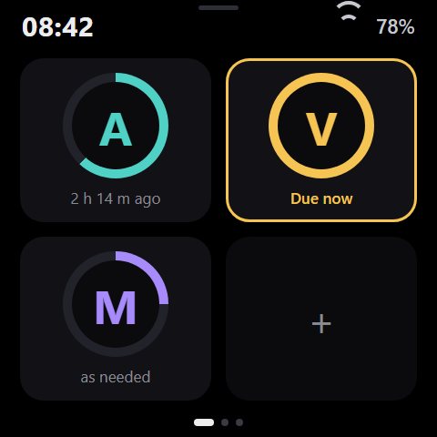
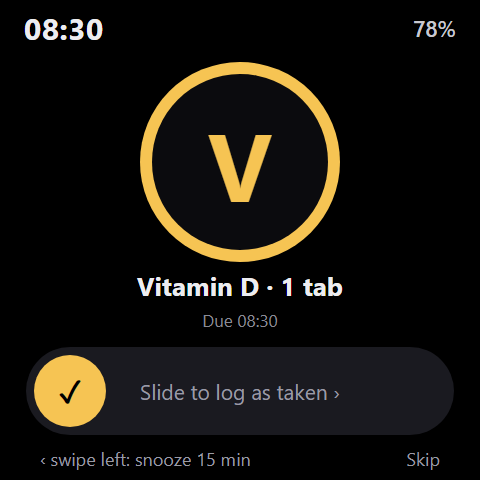

<p align="center">
  
</p>

<h1 align="center">Hygeia</h1>

<p align="center">
  <a href="https://github.com/giovi321/hygeia/actions/workflows/ci.yml"></a>
  <a href="https://github.com/giovi321/hygeia/actions/workflows/docs.yml"></a>
  <a href="LICENSE"></a>
  
</p>

<p align="center">
  <a href="https://giovi321.github.io/hygeia/"></a>
</p>

> **Not a medical device.** Hygeia is a personal reminder tool. Do not rely on it as the only safeguard for medication that must not be missed.

Hygeia is ESP32-S3 firmware for the Waveshare ESP32-S3-Touch-AMOLED-2.16 that reminds you about medicine doses and logs them. Logging a dose is one tap on a tile. At scheduled times the screen shows a full-screen card and plays a chime. It works with no network, no account and no cloud.

This is firmware version 0.3.0, a pre-release: Wi-Fi and the web UI come in a later version. The documentation is at [giovi321.github.io/hygeia](https://giovi321.github.io/hygeia/); the sources of the pages are in [`docs/src/content/docs`](docs/src/content/docs).

<p align="center">
  
  
</p>

The images are design mockups, not photos of the board.

## What works today

- Tiles with a code and a colour per medicine, tap to log, 5 second undo
- Full-screen due card with chime, slide to log, swipe to snooze, skip
- Today overview, 7-day and 30-day history, medicine detail with notes and earlier logging
- Add, edit and archive medicines on the device, with an on-screen keyboard that has a Shift key; the dose is optional
- Quick settings and settings: sound, do not disturb, brightness slider, volume, time zone, date and time, and a battery line that shows only the estimate
- Battery percentage with a charging bolt in the top bar, low (15%) and critical (5%) warnings, and a countdown to power off at critical
- PWR key: short press turns the screen on or off, long press opens a power-off confirmation. The device powers on only with the PWR key
- On battery the screen dims after 30 seconds and turns off after 2 minutes, with the CPU in light sleep; touch, the RTC alarm and the PWR key wake it
- Idle clock with burn-in drift
- Clock from the onboard RTC, medicines and log stored on the device flash

## What does not exist yet

Wi-Fi and access point mode, the web UI, MQTT with Home Assistant discovery, and webhooks are planned and not built. Log entries cannot be edited or deleted on the device. A fresh device holds three example medicines that you can edit or archive. See the [Roadmap](docs/src/content/docs/roadmap.md).

## Quick start

You need ESP-IDF v6.0.2 and the board connected over USB-C.

```powershell
& $env:USERPROFILE\esp-idf-v6.0.2\export.ps1
idf.py build
idf.py -p <port> flash
```

On first boot the device shows the "Set the time" screen until you set the date, time and zone. Details are in [Build and flash](docs/src/content/docs/getting-started/flashing.md) and [First boot](docs/src/content/docs/getting-started/first-boot.md).

Release build, without the serial debug console:

```bash
idf.py -B build-rel -D SDKCONFIG=build-rel/sdkconfig -D SDKCONFIG_DEFAULTS="sdkconfig.defaults;sdkconfig.release" build
```

## Hardware

| Part | Detail |
|---|---|
| Board | Waveshare ESP32-S3-Touch-AMOLED-2.16 |
| MCU | ESP32-S3R8, 8 MB octal PSRAM, 16 MB flash |
| Display | 2.16 inch 480x480 AMOLED (CO5300, QSPI) with capacitive touch |
| PMU, RTC, audio | AXP2101, PCF85063, ES8311 |

## Tech stack

| Component | Technology |
|---|---|
| Firmware | C on ESP-IDF v6.0.2 |
| UI | LVGL 9.6.0 with esp_lvgl_port, hand-written screens |
| Board support | Waveshare registry component 2.0.1 |
| Storage | LittleFS for medicines and log, NVS for settings |
| Host tests | plain C with Unity and cJSON, run with `make -C host_tests test` |
| Docs | Astro Starlight in `docs/` |

## Development

```bash
make -C host_tests test
cd docs && npm ci && npm run build
```

The design spec is `design/spec.md` and the board measurements are in `design/hardware-notes.md`.

## Licence

Released under [CC BY-NC-SA 4.0](LICENSE). The project is source-available for non-commercial use and is not open source. Third-party components and their licences are listed on the [Licence](docs/src/content/docs/licence.md) page.
